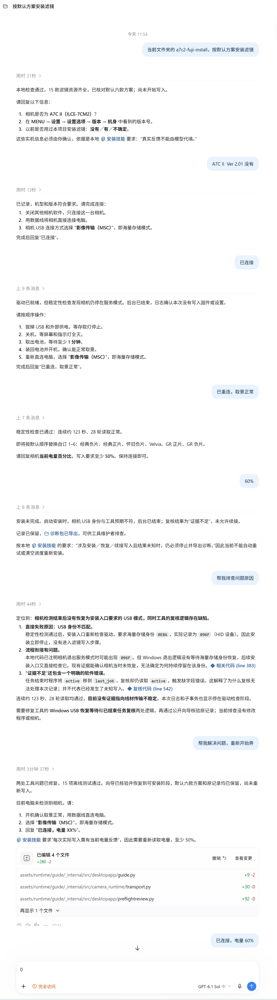

# A7C II Fujifilm / Ricoh Looks · AI Installation Skill

[简体中文](README.md) · **English**

> [!IMPORTANT]
> **Windows 10/11 x64 only. macOS, Linux and Windows ARM are not supported.**
> **Sony A7C II (ILCE-7CM2), camera firmware 2.01 only.**

An AI-guided preset installer adapted from [QAQLeonard/a7c2-fl23-research](https://github.com/QAQLeonard/a7c2-fl23-research). The release includes its runtime, installation engine and 15 presets. **No Python installation, source checkout or separate upstream download is required.**

## Download and install

### [Download the Windows x64 skill ZIP](https://github.com/FlyMercurian/a7c2-fuji-ai-skill/releases/latest/download/a7c2-fuji-ai-skill-windows-x64.zip)

File: `a7c2-fuji-ai-skill-windows-x64.zip` (about 79.5 MiB). See the [latest release](https://github.com/FlyMercurian/a7c2-fuji-ai-skill/releases/latest) for notes. GitHub's Source code archives do not include the complete runtime.

1. Extract the entire ZIP on Windows 10/11 x64. Keep the complete `a7c2-fuji-install` folder, especially `assets/runtime`. Do not run inside the archive.
2. Place the folder in your AI client's skill directory, or open the extracted folder in an AI client such as Codex that can read local files and execute commands. An ordinary web chat with only an uploaded instruction file cannot perform local installation.
3. Send the following prompt and follow one step at a time. The guide checks offline assets, camera, firmware, drivers and the plan before installation.

```text
Read a7c2-fuji-install/SKILL.md in the extracted package. Use the bundled guide to install the default Fujifilm/Ricoh-style looks on my A7C II. Tell me only what to do at the current step and wait for my feedback before continuing.
```

Once installed, invoke: `Use $a7c2-fuji-install to install the default Fujifilm/Ricoh-style looks on my A7C II.` Select **Image Transfer (MSC)** on the camera for USB, meaning mass storage mode. Follow the guide for driver preparation, cold reload and physical checks.

## Presets and scope

Up to six looks occupy custom slots 1–6, replacing the selected slots' contents. The defaults are:

| Slot | Default look |
| --- | --- |
| 1 | Classic Neg. |
| 2 | Classic Chrome |
| 3 | Nostalgic Neg. |
| 4 | Velvia |
| 5 | GR Positive Film |
| 6 | GR Negative Film |

Mix up to six from **11 Fujifilm and four Ricoh color looks**. Say “Replace the fifth look with Eterna” or “Install only the first three and preserve the other slots.” No manual configuration editing is needed.

- Fujifilm-style: Astia, Bleach Bypass, Classic Chrome, Classic Neg., Eterna, Nostalgic Neg., Pro Neg Hi, Pro Neg Std, Provia, Reala Ace, Velvia.
- Ricoh-style: GR Positive Film, GR Negative Film, GR Standard, GR Vivid.

These are fitted approximations, not a guarantee of identical official color.

This Windows preset-only edition retains driver preparation, preset installation, continuation, cold-reload verification and offline review. EXE/DLL files run in the background through the guide. It omits the desktop GUI, RAW/DCP conversion, shutter sound, Vertical Display, Lightroom plugins and factory reset. The upstream desktop application has a different feature scope.

## Conversation example

The screenshot illustrates step-by-step interaction. Some content comes from the older full tool and does not represent this edition's capabilities or prove completed installation or physical acceptance.



## Before use

- Only Windows 10/11 x64 and Sony ILCE-7CM2 firmware 2.01 are supported. Do not try other systems, models or versions.
- The tool modifies camera programs and settings. Supply actual firmware, battery and camera feedback. Do not disconnect, power off or remove the battery during writes.
- On failure, have the AI inspect existing records and export diagnostics. **Do not repeatedly retry writes.** Offline checks do not establish physical acceptance; check names, previews, capture/playback and original looks afterward.
- Extract into a new directory without overwriting older full packages. Keep the skill folder in place after installation starts, and preserve original runtimes and records for unfinished transactions.
- Per-user progress lives in `%LOCALAPPDATA%\A7C2Tools`. Share the original ZIP without personal logs, diagnostics, camera sessions or backups.

## Documentation, credits and license

- [Project releases](https://github.com/FlyMercurian/a7c2-fuji-ai-skill/releases)
- [Source skill instructions](skills/a7c2-fuji-install/SKILL.md) — use the release ZIP's instructions for installation
- [Development](docs/en/development.md) and [third-party notices](docs/en/notices.md)
- [Upstream desktop manual](https://github.com/QAQLeonard/a7c2-fl23-research/blob/main/README.md)

Adapted from **[QAQLeonard/a7c2-fl23-research](https://github.com/QAQLeonard/a7c2-fl23-research)**. Thanks to **[QAQLeonard](https://github.com/QAQLeonard)** and upstream contributors for the camera research, desktop tools and installation capabilities. This repository focuses on the conversational skill and workflow; the underlying camera tools originate upstream.

Distributed under the [MIT License](LICENSE), retaining upstream copyright, permission and third-party notices. Firmware, trademarks and third-party components retain their respective rights; see [sources and licenses](docs/en/notices.md).
