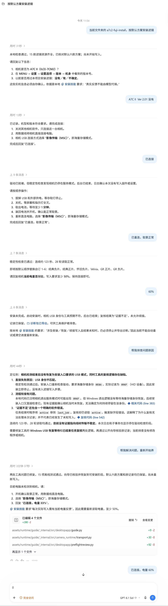

# A7C II 富士／理光滤镜 · AI 安装技能

**简体中文** · [English](README.en.md)

> [!IMPORTANT]
> **仅支持 Windows 10／11 x64。macOS、Linux、Windows ARM 均不支持。**
> **相机仅支持 Sony A7C II（ILCE-7CM2），机身固件必须为 2.01。**

通过能读取本地文件、执行本地命令的 AI，让它一步一步带你给 A7C II 安装富士／理光风格外观。发布包已包含运行环境、安装引擎和 15 款预制滤镜，**无需安装 Python、克隆源码或另行下载上游软件**。

## 下载 Windows 技能包

### [⬇ 下载 Windows x64 技能包](https://github.com/FlyMercurian/a7c2-fuji-ai-skill/releases/latest/download/a7c2-fuji-ai-skill-windows-x64.zip)

文件名：`a7c2-fuji-ai-skill-windows-x64.zip`（约 79.5 MiB）。也可前往 [Releases 下载页](https://github.com/FlyMercurian/a7c2-fuji-ai-skill/releases/latest)查看发布说明。

**请下载 Release 附件中的上述 ZIP。GitHub 自动生成的 Source code 压缩包不包含完整运行环境。**

## 快速开始：让 AI 带你安装

1. 在 **Windows 10／11 x64** 电脑上下载并完整解压 ZIP，保留 `a7c2-fuji-install` 文件夹及全部内容，尤其是 `assets/runtime`。不要在压缩包内直接运行。
2. 将整个 `a7c2-fuji-install` 文件夹放入所用 AI 工具的技能目录；也可用支持本地文件和命令执行的 AI（例如 Codex）打开解压目录，让它读取其中的 `SKILL.md`。普通网页聊天仅上传说明文件无法执行本机安装。
3. 把下面的提示词发给 AI，按它当前给出的步骤操作，并等待每一步的真实结果。AI 会先执行离线自检，再确认相机、固件、驱动和安装方案。

**第一次使用：**

```text
请读取解压目录中 a7c2-fuji-install/SKILL.md，使用随包向导，按默认配置带我给 A7C2 安装富士／理光风格外观。每次只告诉我当前需要做什么，等我反馈后再继续。
```

**已经安装技能：**

```text
使用 $a7c2-fuji-install，按默认配置带我安装 A7C2 富士／理光风格外观。
```

连接时，在相机上选择 **“影像传输（MSC）”**，即海量存储模式。安装过程中按 AI 提示处理驱动准备、断电重开与试拍检查。

## 默认滤镜与可选范围

最多同时安装 6 款，占用自订 1–6；安装会替换所选槽位原有内容。

| 自订槽位 | 默认滤镜 |
| --- | --- |
| 1 | Classic Neg.／经典负片 |
| 2 | Classic Chrome／经典正片 |
| 3 | Nostalgic Neg.／怀旧负片 |
| 4 | Velvia |
| 5 | GR Positive Film／GR 正片 |
| 6 | GR Negative Film／GR 负片 |

可从 **富士 11 款、理光彩色 4 款**中混搭最多 6 个槽位。直接告诉 AI“第五个换成 Eterna”或“只装前三个，保留其他槽位”，无需自己修改配置文件。

- **富士风格：**Astia、Bleach Bypass、Classic Chrome、Classic Neg.、Eterna、Nostalgic Neg.、Pro Neg Hi、Pro Neg Std、Provia、Reala Ace、Velvia。
- **理光风格：**GR 正片、GR 负片、GR 标准、GR 鲜艳。

这些外观是拟合风格，不保证等同富士／理光官方色彩。

## 当前发布包的功能

当前为 **Windows 预制滤镜精简包**，保留驱动准备、预制滤镜安装、安装续接、冷启动核验和离线复核。包内 EXE／DLL 由向导在后台调用，无需手动打开桌面软件。

精简包不包含桌面界面、RAW／DCP 转换、快门声、竖屏、Lightroom 插件或恢复原厂功能。上游完整桌面版的功能范围与本包不同。

## AI 安装对话示例

截图仅展示分步交互方式，部分内容来自旧版完整工具，不代表当前精简包的功能范围，也不代表完整安装或实机验收已经通过。



## 使用前须知

- 仅支持 **Windows 10／11 x64 + Sony A7C II（ILCE-7CM2）固件 2.01**。其他系统、相机型号和固件版本均不支持，请不要尝试。
- 工具会修改相机中的程序和设置。请提供真实的机身版本、电量及操作反馈；写入时不要拔线、关机或取电池。
- 遇到异常先让 AI 检查现有记录并导出诊断，**不要反复重试写入**。离线检查通过不代表实机安装通过，完成后仍需检查名称、预览、拍摄／回放及原有外观。
- 请解压到新目录，不覆盖旧完整版。安装开始后不要移动或删除技能文件夹；如有未完成事务，保留原运行包及记录。
- 配置与进度保存在你自己的 `%LOCALAPPDATA%\A7C2Tools`。分享原始 ZIP 即可，不要加入自己的日志、诊断、相机会话或备份。

## 更多说明

- [本项目 Releases](https://github.com/FlyMercurian/a7c2-fuji-ai-skill/releases)
- [源码中的技能说明](skills/a7c2-fuji-install/SKILL.md)（安装时以 Release 包内的 `SKILL.md` 为准）
- [本地开发／环境准备](docs/zh-CN/development.md)
- [第三方来源与许可](docs/zh-CN/notices.md)
- [上游完整桌面工具说明](https://github.com/QAQLeonard/a7c2-fl23-research/blob/main/README.zh-CN.md)

## 项目来源、致谢与许可

本项目基于 **[QAQLeonard/a7c2-fl23-research](https://github.com/QAQLeonard/a7c2-fl23-research)** 修改。感谢原作者 **[QAQLeonard](https://github.com/QAQLeonard)** 及上游贡献者提供相机研究、桌面工具和安装能力。本仓库侧重对话式技能与安装流程，底层相机工具来自上游项目。

代码沿用 [MIT 开源协议](LICENSE)，保留上游版权声明、许可文本及第三方许可说明。固件、商标和第三方组件仍归各自权利人所有，详见[来源与许可](docs/zh-CN/notices.md)。
